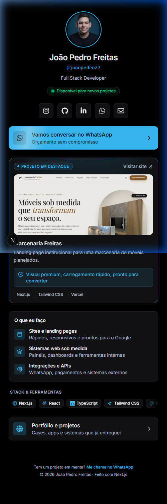

# Link in Bio

Página de link in bio desenvolvida para o perfil de Instagram. Projetada com foco em alta performance no navegador interno do Instagram, carregamento instantâneo, experiência mobile-first e conversão de visitantes em potenciais clientes.

## Demonstração

Aplicação em produção: [https://joaopedrobio.vercel.app/](https://joaopedrobio.vercel.app/)



## Funcionalidades

- **Arquitetura mobile-first:** layout otimizado para celulares e navegadores in-app, garantindo renderização rápida e baixo consumo de dados.
- **Tema escuro profissional:** paleta com fundo preto puro e acento ciano/sky blue, totalmente configurável via variáveis CSS.
- **Dados centralizados:** perfil, redes sociais, serviços e links gerenciados em um único arquivo TypeScript tipado.
- **Rastreamento UTM automático:** utilitário que injeta parâmetros de campanha (`utm_source`, `utm_medium`, `utm_campaign`) em links externos, preservando links diretos de WhatsApp e e-mail.
- **SEO e compartilhamento:** metadados Open Graph e Twitter Cards configurados para prévias ricas em qualquer plataforma.
- **Acessibilidade e semântica:** estrutura com tags HTML5 semânticas, foco visível para navegação por teclado e descrições para leitores de tela.

## Tecnologias

- **Next.js** (App Router e Server Components)
- **TypeScript**
- **Tailwind CSS**
- **react-icons**
- **Vercel** (hospedagem e deploy contínuo)

## Como rodar localmente

1. Clone o repositório:
   ```bash
   git clone https://github.com/JoaoPedroFreitas9/Link-in-Bio.git
   cd Link-in-Bio
   ```

2. Instale as dependências:
   ```bash
   npm install
   ```

3. Inicie o servidor local:
   ```bash
   npm run dev
   ```

4. Acesse no navegador:
   ```
   http://localhost:3000
   ```

## Como personalizar

- **Informações e links:** atualize o arquivo `data/links.ts` para modificar os dados do perfil, serviços oferecidos, projeto em destaque e links de contato.
- **Cores e estilo:** ajuste as variáveis no seletor `:root` em `app/globals.css` (`--bg`, `--card`, `--border`, `--fg`, `--muted`, `--accent`, `--on-accent`).

## Estrutura do projeto

```
link-in-bio/
├── app/
│   ├── globals.css              # Variáveis CSS e tokens de design
│   ├── layout.tsx               # Layout raiz, fontes e metadados SEO/OG
│   └── page.tsx                 # Composição da página inicial (Server Component)
├── components/
│   ├── FeaturedProjectCard.tsx  # Card do projeto em destaque com captura de tela
│   ├── Footer.tsx               # Rodapé discreto com copyright e link rápido
│   ├── LinkCard.tsx             # Card de link com variantes de destaque
│   ├── Profile.tsx              # Cabeçalho, avatar e selo de disponibilidade
│   ├── ServicesSection.tsx      # Card compacto com serviços oferecidos
│   └── SocialRow.tsx            # Linha de botões das redes sociais
├── data/
│   └── links.ts                 # Conteúdo da aplicação tipado e centralizado
├── docs/
│   └── preview.png              # Imagem de demonstração para a documentação
├── lib/
│   └── utm.ts                   # Utilitário para inclusão de parâmetros UTM
└── public/                      # Imagens otimizadas e arquivos públicos
```

## Autor

João Pedro Freitas
- GitHub: [https://github.com/JoaoPedroFreitas9](https://github.com/JoaoPedroFreitas9)
- LinkedIn: [https://www.linkedin.com/in/jo%C3%A3o-pedro-freitas9/](https://www.linkedin.com/in/jo%C3%A3o-pedro-freitas9/)