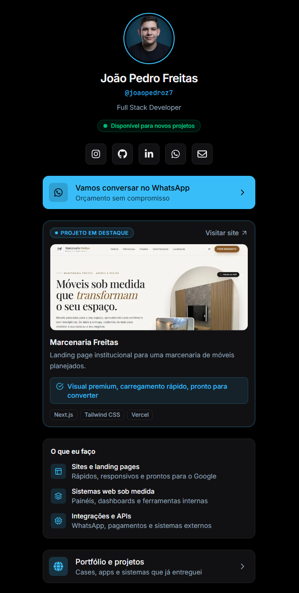

# Link in Bio

Página de links para perfil do Instagram, desenvolvida com Next.js, TypeScript e Tailwind CSS. O projeto reúne informações de perfil, redes sociais, serviços, projetos e canais de contato em uma única página, com interface adaptada para dispositivos móveis.

## Demonstração

**Aplicação em produção:** [joaopedrobio.vercel.app](https://joaopedrobio.vercel.app/)



## Funcionalidades

- **Layout responsivo:** interface mobile-first, adaptada a diferentes tamanhos de tela e ao uso em navegadores integrados a aplicativos.
- **Conteúdo centralizado:** informações do perfil, serviços, redes sociais e links organizados em um único arquivo TypeScript.
- **Parâmetros UTM:** inclusão automática de parâmetros de campanha em links externos compatíveis, facilitando a identificação da origem dos acessos.
- **Metadados para compartilhamento:** configuração de Open Graph e Twitter Cards para exibição de informações da página ao compartilhar o link.
- **Acessibilidade:** uso de elementos HTML semânticos, indicadores de foco e descrições acessíveis para componentes relevantes.
- **Personalização visual:** cores e elementos do tema configurados por variáveis CSS.
- **Componentização:** interface dividida em componentes reutilizáveis, facilitando a manutenção e a evolução do projeto.

## Tecnologias

| Tecnologia | Aplicação |
|---|---|
| Next.js | Estrutura da aplicação com App Router |
| TypeScript | Tipagem estática e organização dos dados |
| Tailwind CSS | Estilização da interface |
| React Icons | Ícones de redes sociais e elementos da interface |
| Vercel | Hospedagem e integração com o fluxo de deploy |

## Executando o projeto

### Requisitos

- Node.js em uma versão compatível com o Next.js utilizado no projeto.
- npm.

### Instalação

Clone o repositório e acesse o diretório:

```bash
git clone https://github.com/JoaoPedroFreitas9/Link-in-Bio.git
cd Link-in-Bio
```

Instale as dependências:

```bash
npm install
```

Inicie o servidor de desenvolvimento:

```bash
npm run dev
```

Acesse a aplicação em [http://localhost:3000](http://localhost:3000).

## Personalização

### Informações e links

Edite o arquivo `data/links.ts` para atualizar os dados do perfil, as redes sociais, os serviços, o projeto em destaque e os canais de contato.

### Identidade visual

As variáveis de tema estão definidas em `app/globals.css`, no seletor `:root`.

As principais variáveis são:

- `--bg`: cor de fundo.
- `--card`: fundo dos cards.
- `--border`: cor das bordas.
- `--fg`: cor principal do texto.
- `--muted`: cor dos textos secundários.
- `--accent`: cor de destaque.
- `--on-accent`: cor do conteúdo sobre elementos destacados.

## Estrutura do projeto

```text
link-in-bio/
├── app/
│   ├── globals.css
│   ├── layout.tsx
│   └── page.tsx
├── components/
│   ├── FeaturedProjectCard.tsx
│   ├── Footer.tsx
│   ├── LinkCard.tsx
│   ├── Profile.tsx
│   ├── ServicesSection.tsx
│   ├── SocialRow.tsx
│   └── TechMarquee.tsx
├── data/
│   └── links.ts
├── docs/
│   └── preview.png
├── lib/
│   └── utm.ts
└── public/
```

### Organização dos diretórios

- `app/`: páginas, layout raiz, metadados e estilos globais.
- `components/`: componentes responsáveis pelas diferentes seções da interface.
- `data/`: dados centralizados da aplicação.
- `docs/`: imagens utilizadas na documentação.
- `lib/`: funções utilitárias.
- `public/`: arquivos estáticos disponibilizados pela aplicação.

## Autor

**João Pedro Freitas**

- GitHub: [JoaoPedroFreitas9](https://github.com/JoaoPedroFreitas9)
- LinkedIn: [João Pedro Freitas](https://www.linkedin.com/in/jo%C3%A3o-pedro-freitas9/)
